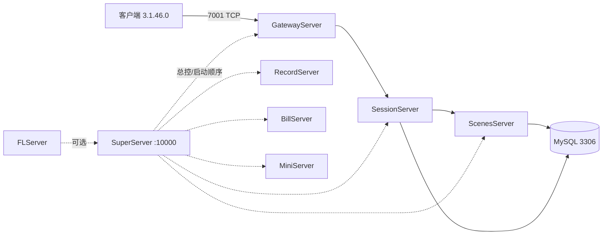

# 架构与拓扑

## 1. 进程拓扑



## 2. 进程清单

| 进程 | 职责 | 监听 | 启动顺序 | 启动等待 | 来源 |
|---|---|---|---|---|---|
| `SuperServer` | 总控 / 进程守护 | 10000 | 1 | 5 s | `SuperServer.cpp: Port = 10000` |
| `RecordServer` | 记录落库 | 内部 | 2 | 5 s | `start.sh` |
| `BillServer` | 计费 | 内部 | 3 | 5 s | `start.sh` |
| `MiniServer` | 小游戏（DDZ 等） | 内部 | 4 | 5 s | `start.sh` |
| `SessionServer` | 会话 / 登录态 | 待实测 | 5 | 10 s | `start.sh` |
| `ScenesServer` | 场景逻辑 | 待实测 | 6 | 10 s | `start.sh` |
| `GatewayServer` | 客户端接入 | 7001（假设） | 7 | — | 待 P1 实测 |
| `FLServer` | 附服（start.sh 中注释） | 内部 | 可选 | 5 s | `start.sh` |

> `start.sh` 实测顺序：Super → Record → Bill → Mini → Session → Scenes → Gateway，累计最小启动窗口 **35 s**（5+5+5+5+10+10）。runbook 按此写超时。

## 3. 端口规划

| 端口 | 用途 | 绑定 | 对外 |
|---|---|---|---|
| 7001 | 客户端接入（Gateway） | 0.0.0.0 | 是（NAT 唯一入口） |
| 7002 | 网关内部 / 会话 | 内网 | 白名单 |
| 7003 | GM 后台 | 127.0.0.1 | 否 |
| 10000 | SuperServer 总控 | 内网 | 否 |
| 3306 | MySQL | 内网 | 否 |

## 4. 源码规模

| 树 | 文件数 | 语言构成 | 构建 |
|---|---|---|---|
| `src/server` | 2473 | C++ 273 `.cpp` / 279 `.h` / xml 1468 / lua 167 | `Makefile`（gcc，32 位） |
| `src/client` | — | C++ / Lua 5.0.2 / boost 1.34.1 | VS2022（`build.bat`） |
| `src/client-legacy` | — | C++ / VC2005 工程 | 仅对照，不构建 |

## 5. 数据流

```
客户端 → [加密包] → Gateway → 解密 → Session 鉴权 → Scenes 逻辑 → MySQL
                                    ↓
                              Record/Bill 异步落库
```

抓包点：客户端侧 `dumpcap`（明文比对）+ 服务端 `hexdump`（前 64 字节），两端按 opcode 对齐——P5 的双向比对基础。
