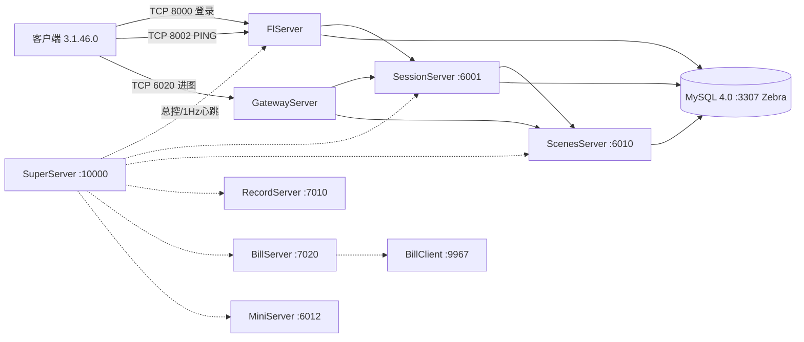

# 架构与拓扑

> **2026-11-27 更正**：本节按目标机 `101.33.242.142` 实测结果重写。原稿的 `7001/7002` 网关端口、`Mini` 先于 `Session` 的启动顺序、"Linux 原生 Makefile 部署"三项均与实机不符。实测证据见 `docs/deploy/server-env.md`。

## 1. 进程拓扑（实测）



客户端是**两段连接**：先从 `8000` 登录拿网关地址，再连 `6020` 进图。`8001` 只做服间内联，不对客户端开放。

## 2. 进程清单（实测，`ss -lntp` + `ps -ef`）

| 进程 | 职责 | 监听端口 | 实测启动顺序 | 落地方式 |
|---|---|---|---|---|
| `SuperServer_r.exe` | 总控 / 进程守护 / 1 Hz 心跳 | 10000 | 1 | Wine |
| `RecordServer_r.exe` | 记录落库 | 7010 | 2 | Wine |
| `BillServer_r.exe` | 计费 | 7020（对客户端 9967） | 3 | Wine |
| `FlServer_r.exe` | 账号登录 / 区列表 / PING | 8000 / 8001 / 8002 | 4 | Wine |
| `SessionServer_r.exe` | 会话 / 登录态 | 6001 | 5 | Wine |
| `GatewayServer_r.exe` | 客户端接入（进图） | 6020（**延迟开监听**） | 6 | Wine |
| `ScenesServer_r.exe` | 场景逻辑 | 6010 | 7 | Wine |
| `MiniServer_r.exe` | 小游戏（大厅/牌类） | 6012 | 8 | Wine |
| `mysqld.exe` | 数据库 | 3307 | 0（先起） | Wine（MySQL 4.0） |
| `Xvfb` | 假显示，服务端全是 GUI 程序 | 6099 | 0 | 原生 |

启动编排脚本 `/root/boot_all.sh` 实测顺序：**Super → Record → Bill → FL → Session → Gateway → Scenes → Mini**，每服等窗口最长 180–300 s。

> 关键差异：Mini **最后**起，不是第 4 个；FL 在 Session 之前；Gateway 在 Scenes 之前，但**监听口在 Scenes 就位后才打开**（08:13 无 6020、08:20 有 6020，期间未重启进程）。
>
> 服务端全是 Win32 GUI 程序，靠 `xdotool` 点工具栏「启动服务」按钮（坐标 `18,33`）后才真正 bind 端口。**只 `wine xxx.exe` 不等于服务已启动** —— 这是部署最容易踩的坑。

## 3. 端口规划（实测）

| 端口 | 用途 | 绑定地址 | 对外 | 备注 |
|---|---|---|---|---|
| 8000 | 客户端登录（FlServer） | 10.1.0.10 | 是 | `config.xml <login_port>` |
| 8001 | 服间内联 | 10.1.0.10 | 否 | `<inside_port>` |
| 8002 | 客户端 PING | 10.1.0.10 | 是 | `<ping_port>`，实测由 `FlServer_r.exe` 直接持有 |
| 6020 | 客户端进图（Gateway） | 10.1.0.10 | 是 | 延迟 bind |
| 6001 | SessionServer | 10.1.0.10 | 否 | |
| 6010 | ScenesServer | 10.1.0.10 | 否 | 当前缺失（见 §6） |
| 6012 | MiniServer | 10.1.0.10 | 否 | |
| 7010 | RecordServer | 10.1.0.10 | 否 | |
| 7020 | BillServer | 10.1.0.10 | 否 | |
| 9967 | BillClient | 10.1.0.10 | 否 | `billServerList.xml` |
| 10000 | SuperServer | 10.1.0.10 | 否 | `SuperServer.cpp: Port = 10000` |
| 3307 | MySQL 4.0 | 127.0.0.1 | 否 | Wine 内 `mysqld.exe` |
| 6099 | Xvfb `:99` | * | 否 | 6000+display |

> 内网地址固定 `10.1.0.10/22`，硬编码在 `config.xml <ifname>`、`zoneInfo.xml`、`loginServerList.xml`、`billServerList.xml` 四处。换机必须先改这四处，否则服间连接全断。

## 4. 源码规模

| 树 | 文件数 | 语言构成 | 构建 |
|---|---|---|---|
| `src/server` | 2473 | C++ 273 `.cpp` / 279 `.h` / xml 1468 / lua 167 | `Makefile`（gcc 4.8.5，32 位）—— **产出未被使用**，实机跑的是预编译 PE |
| `src/client` | — | C++ / Lua 5.0.2 / boost 1.34.1 | VS2022（`build.bat`） |
| `src/client-legacy` | — | C++ / VC2005 工程 | 仅对照，不构建 |

> 实测结论：服务端**不需要**重新编译成 Linux ELF。目标机直接跑 `*_r.exe`（Wine 4.0.4，win32 前缀 `/root/.wine32`）。P3 的"C++ 服务端还原"因此从"部署必需"降级为"协议与逻辑取证手段"，工期可压缩。

## 5. 数据流

```
客户端 → [帧: 4B长度头 + body，8 字节块 RC5/DES] → FlServer(8000) 验版本/账号
       → 0x0104 下发网关地址 + DES 密钥(key[keyOffset])
客户端 → [DES-ECB] → Gateway(6020) → Session(6001) 鉴权 → Scenes(6010) 逻辑 → MySQL(3307)
                                              ↓
                                     Record(7010) / Bill(7020) 异步落库
```

抓包点已从"客户端 dumpcap"扩展为**三处**：

1. 服务端 `tcpdump -i any`（现成，无需管理员）—— `tools/capture-server.sh` / `tools/remote.py capture`
2. 客户端侧 `pktmon`（需管理员）—— `tools/capture.ps1`
3. 服务端日志 `hexdump`（前 N 字节）

P5 三方比对基础由此成立。

## 6. 当前拓扑缺口

`ScenesServer` 未运行 → 6010 无监听 → 客户端进图失败。报错弹窗 `System Error. Code: 5. Access denied.`（截图 `docs/deploy/img/scenes-error-code5.png`），已排除网卡/端口/文件权限三类表观原因，指向 Wine 文件系统映射。详见 `docs/deploy/server-env.md §6`。
